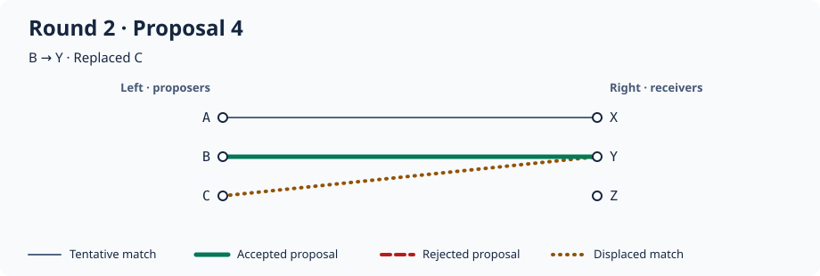
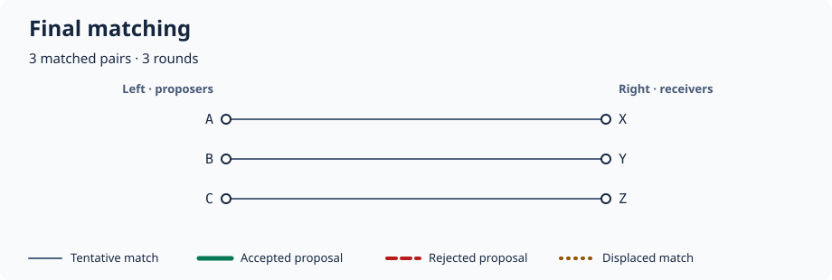
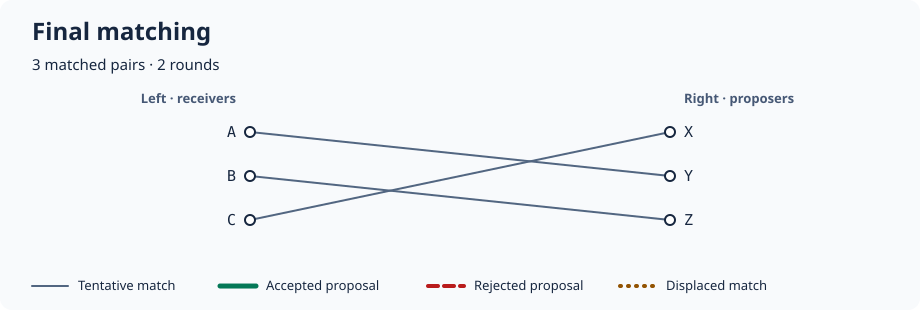

# Gale–Shapley Stability

A Rust CLI for exploring stable one-to-one matching. Give two equally sized
groups complete, strict preference lists and run deferred acceptance with either
side proposing. The output explains each tentative match and rejection, ranks
the final partners on both sides, and checks the result for blocking pairs.

## Run the examples

Requires Rust 1.85 or later. The application has no external dependencies.

```sh
cargo run --locked -- solve examples/side-switch.txt
cargo run --locked -- solve examples/side-switch.txt --proposers right --summary
cargo run --locked -- solve examples/side-switch.txt --svg-dir artifacts/side-switch
cargo run --locked -- check examples/side-switch.txt examples/unstable-matching.txt
```

`solve` runs both directions by default and reports how many pairs changed.
`--summary` hides the console proposal trace. SVG files are grouped by proposing
side and include an initial state, a frame for each proposal, and the final
matching. Use a fresh output directory on reruns. Existing frames are preserved.

The first example has exactly two stable matchings among its six possible
assignments. Both runs are stable and each gives its proposers their best
achievable partners among the stable matchings.

| Proposing side | Final pairs | Proposals | Rejections | Rounds |
| --- | --- | ---: | ---: | ---: |
| Left | A–X, B–Y, C–Z | 5 | 2 | 3 |
| Right | A–Y, B–Z, C–X | 4 | 1 | 2 |

`check` reports the pairs that would both prefer each other to their assigned
partners. In the supplied unstable matching, A–X and A–Y both block.

### Proposal replay

The loop plays the left-proposing run followed by the right-proposing run.
Each frame shows the new proposal, its outcome, and the current tentative matches.

<picture>
  <source media="(prefers-reduced-motion: reduce)" srcset="docs/images/side-switch-left-final.svg">
  
</picture>

From the repository root, generate both runs and compare the result with the
SVG used above.

```sh
cargo run --locked -- solve examples/side-switch.txt --proposers both --animated-svg artifacts/side-switch-replay.svg
git diff --no-index --ignore-cr-at-eol -- docs/images/side-switch-replay.svg artifacts/side-switch-replay.svg
```

Use `--proposers left` or `--proposers right` for a single-run animation.
`--animated-svg` can be combined with `--svg-dir` to export both formats in one
command. Choose a fresh animation path on reruns because the CLI preserves
existing files.

### B displaces C

In round 2 of the left-proposing run, Y receives B's proposal and prefers B to
its tentative partner C. C returns to the queue and proposes to Z in round 3.



### Final matchings

**Left side proposes**



**Right side proposes**



## Input

Use a UTF-8 profile with one `[left]` section and one `[right]` section.
Each row takes the form `participant: first-choice second-choice …`.
Identifiers are case-sensitive single tokens and each participant ranks every
member of the opposite group exactly once. Blank lines are ignored and `#`
starts a comment. For `check`, supply a second file of `left: right` rows that
match every participant exactly once.

Balanced profiles of any positive size are accepted. The blocking-pair check
runs at every size. Through five participants per side, a separate verifier
enumerates all `n!` assignments, checks stability directly against the original
preference orders, and compares each proposer's partner rank with their best
rank over all stable assignments.

## Trace and metrics

- A round gives every proposer who is free at its start one turn. Proposals are
  resolved in queue order, starting with profile order. Rejected and displaced
  proposers return for the next round.
- The rejection count includes both immediately declined proposals and
  displaced tentative partners. Displayed partner ranks start at 1.
- Solve time includes construction of the structured trace and excludes parsing,
  verification, console output, and SVG export.
- The solver uses inverse ranks for constant-time receiver comparisons and
  makes at most `n²` proposals. SVG export draws `O(n)` elements per frame
  and its output size grows with the proposal count.

Exit codes are `0` for success, `1` for a valid but unstable supplied matching,
`2` for command, input, or export errors, and `3` for a solver result that
fails a correctness check.

## Stability and assignment cost

The companion [Hungarian Assignment Visualizer](https://github.com/andrii2g/hungarian-assignment-visualizer)
minimizes a cost matrix. For a concrete comparison, take
`examples/cost-vs-stability.txt` and give each pair a cost equal to the sum
of the two participants' one-based ranks. The cheapest assignment has total
cost 11. Every stable assignment costs 12 under that scoring rule.

```sh
cargo run --locked -- solve examples/cost-vs-stability.txt --summary
cargo run --locked -- check examples/cost-vs-stability.txt examples/rank-sum-minimum.txt
```

The cheapest assignment matches B with Y and C with Z. B prefers Z to Y, and
Z prefers B to C, so B–Z blocks the minimum-cost assignment.

## Development

```sh
cargo fmt --check
cargo clippy --locked --all-targets -- -D warnings
cargo test --locked
```

Algorithm reference [Gale and Shapley, *College Admissions and the Stability of Marriage*](https://doi.org/10.1080/00029890.1962.11989827).
